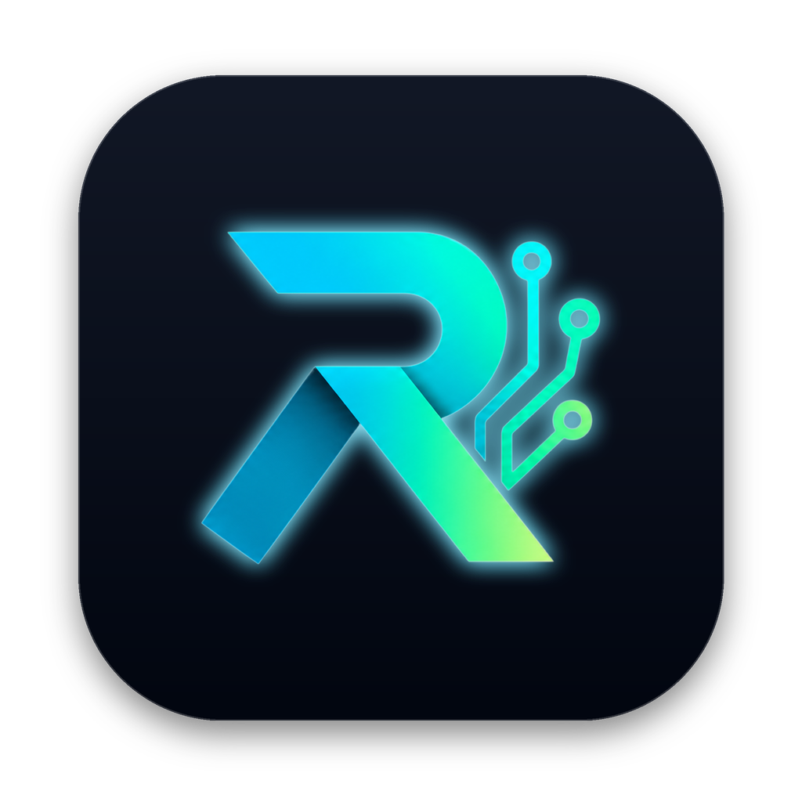
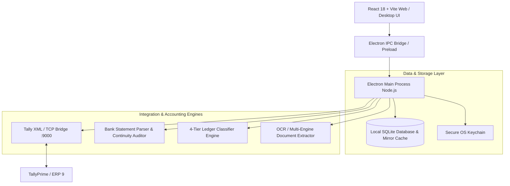

# ReconcAILe Hub 🚀

<p align="center">
  
</p>


An enterprise AI-powered accounting automation hub and desktop bridge designed for seamless synchronization with **TallyPrime**, automated bank reconciliation (BRS), AI invoice OCR extraction, and multi-entity financial management.

[](https://github.com/I-am-Manu-Singh/reconcAIle-Hub/actions/workflows/web-build.yml)
[](https://vercel.com)

---

## 🏗️ Architecture Overview

ReconcAILe Hub uses a **hybrid desktop-first & web-ready architecture** designed for high throughput, data sovereignty, and offline resilience:



### The 4-Tier Ledger Classifier
1. **Tier 1 (Exact & Regex Rule Matching)**: High-confidence user-curated rules and keywords stored in SQLite.
2. **Tier 2 (Historical Learning)**: Past approved counterparty-to-ledger assignments from previous bank statements.
3. **Tier 3 (Fuzzy Token Similarity)**: High-speed Fuse.js fuzzy string distance matching against Tally's Chart of Accounts.
4. **Tier 4 (Local / Cloud LLM Inference)**: Smart semantic ledger inference via local SmallLM / Groq / Google GenAI when configured.

---

## 📱 App Screenshots

<p align="center">
  <table>
    <tr>
      <td align="center" width="25%">
        <br />
        <b>1. Main Screen</b>
      </td>
      <td align="center" width="25%">
        <br />
        <b>2. Core Experience</b>
      </td>
      <td align="center" width="25%">
        <br />
        <b>3. Interactive Mode</b>
      </td>
      <td align="center" width="25%">
        <br />
        <b>4. Advanced Features</b>
      </td>
    </tr>
    <tr>
      <td align="center" width="25%">
        <br />
        <b>5. Workflow / Details</b>
      </td>
      <td align="center" width="25%">
        <br />
        <b>6. Studio Console</b>
      </td>
      <td align="center" width="25%">
        <br />
        <b>7. Settings & Config</b>
      </td>
      <td align="center" width="25%">
        <br />
        <b>8. Dark & Light Theme</b>
      </td>
    </tr>
  </table>
</p>

---

## ✨ Core Features

- 🏦 **Automated Bank Statement Parsing & BRS**:
  - Full support for major Indian public & private banks: HDFC, ICICI, SBI, Axis, Kotak, PNB, Bank of Baroda, Federal, Canara, and more.
  - Automatic balance continuity verification across statements with transaction-level audit checks.
  - Multi-account detection with automatic last-4-digits IBAN/account isolation.
  - Password-protected statement unlock dialog.
- 📋 **Master Voucher Register & Chart of Accounts**:
  - Real-time mirrored replica of Tally transactions, ledgers, and stock items.
  - Full-period and custom date-boundary filtering (FY 2017-18 up to FY 2026-27 + All Periods Unified).
  - Split transaction allocation with multi-ledger legs.
- 🖨️ **Universal Print Setup & PDF Engine**:
  - Live preview modal for voucher & report printing with instant landscape/portrait, zoom, font sizing, and field toggling.
  - Clean vector PDF export generation without screen artifacts or UI interference.
- 🔄 **Direct 2-Way TallyPrime Connector**:
  - Native XML synchronization over port 9000.
  - Real-time company switching, reverse sync, and bulk voucher push.
- 🌐 **Web Deployable via Vercel**:
  - Isolated Vite renderer bundle that runs seamlessly in browser mode for reporting, review, and client portal viewing.

---

## 🛠️ Technologies & Packages

| Category | Technologies |
| :--- | :--- |
| **Frontend UI** | React 18, TypeScript, Vite 6, Lucide React, Dynamic Data Table, CSS Grid |
| **Desktop Platform** | Electron 35, Node.js, IPC Preload Bridge, Electron Builder |
| **Database & Caching** | `better-sqlite3`, Local SQLite Schema, WAL mode |
| **Document & PDF Processing** | `pdfjs-dist`, `pdf-parse`, Canvas PDF Viewer, XLSX, Fast-XML-Parser |
| **AI & NLP** | `@google/genai`, `groq-sdk`, `fuse.js`, `node-llama-cpp` |
| **Security** | OS-level Keychain (`keytar`), CSP security policies, Sanitized XML builders |
| **CI/CD & Cloud** | GitHub Actions (`.github/workflows/web-build.yml`), Vercel (`vercel.json`) |

---

## 🚀 Getting Started

### Prerequisites
- Node.js 20+ installed
- npm or yarn

### 1. Installation
```bash
git clone https://github.com/I-am-Manu-Singh/reconcAIle-Hub.git
cd reconcAIle-Hub
npm install
```

### 2. Run Desktop Development App
```bash
npm run dev      # In terminal 1 (starts Vite dev server)
npm run electron # In terminal 2 (launches Electron shell)
```

### 3. Build Web Bundle (for Vercel / Cloud)
```bash
npm run build:renderer
```
The output directory will be `dist/renderer`.

---

## 🌐 Deploying to Vercel (Free Web Domain)

1. Go to [vercel.com/new](https://vercel.com/new).
2. Connect your GitHub account and import **`I-am-Manu-Singh/reconcAIle-Hub`**.
3. Vercel will automatically read the root [vercel.json](file:///Users/manpreet/Desktop/VSCodeProjects/TallyPlugin/vercel.json):
   - **Framework Preset**: Vite
   - **Build Command**: `npm run build:renderer`
   - **Output Directory**: `dist/renderer`
4. Click **Deploy** to get your free `*.vercel.app` domain URL.

---

## 📄 License
Private & Proprietary © CreativeBlissLabs.
